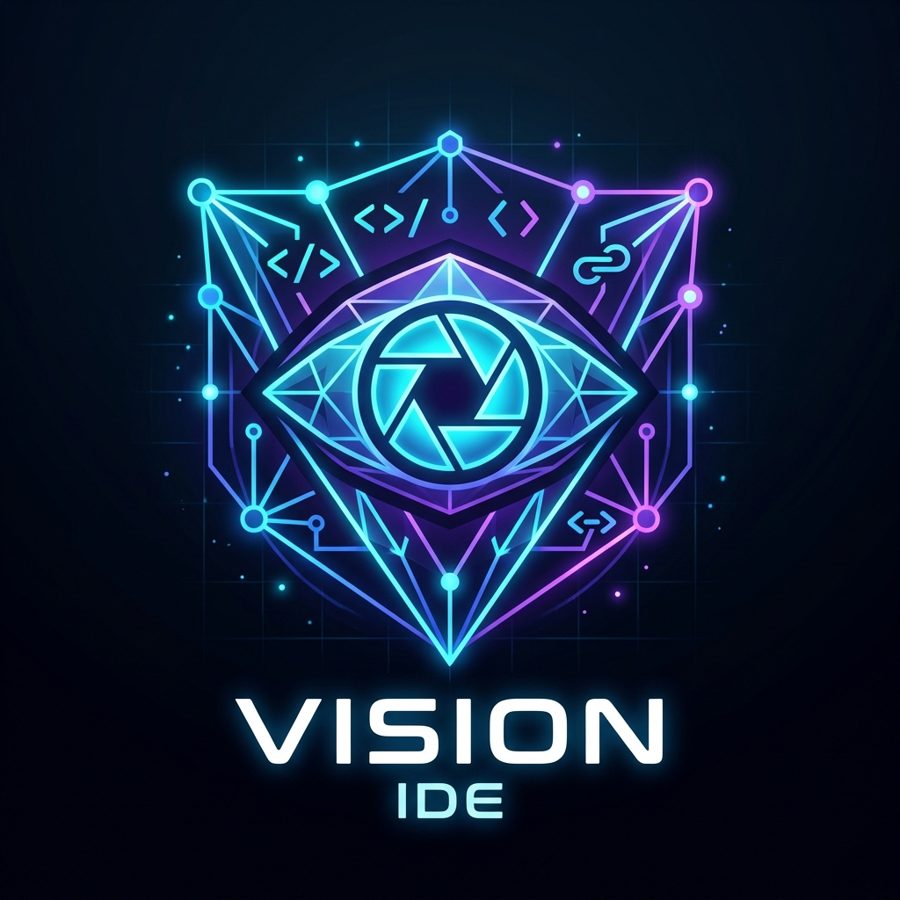

<p align="center">
  
</p>

<h1 align="center">Vision IDE</h1>

<p align="center">
  <strong>The Visual-First Desktop Code Editor & Codebase Architecture Visualizer</strong>
</p>

<p align="center">
  Uniting the instant code exploration of <strong>Monaco Editor</strong> (VS Code core, file tree, git status & diffs) with the visual intelligence of <strong>GitDiagram</strong> (interactive codebase architecture diagrams, AST import dependency graphs, call hierarchies, and zero-overlap layout engine) into a single unified desktop app that works 100% offline on any local folder or Git repository.
</p>

---

## Highlights

- ⚡ **Instant Code Exploration & Monaco Engine**
  - Full **Monaco Editor** with VS Code Dark Modern theme.
  - Multi-tab management, breadcrumbs navigation, minimap, syntax highlighting for 40+ programming languages.
  - Side-by-side and inline **Git Diff Editor** for working copy changes and commit history.
  - Official vector file icons for all modern languages, runtimes, and configs.
  - Media & binary preview for images, SVGs, audio, and documents.

- 📦 **Visual Architecture & Zero-Overlap Diagram Engine**
  - **Architecture Clusters**: Visual directory container boxes grouping related files into clean architectural rank columns (Entrypoints $\rightarrow$ Views $\rightarrow$ Services $\rightarrow$ Utils).
  - **Dependency Flow (Topological DAG)**: Topological layout tracking AST `import`, `require`, and `use` specifiers across JS/TS, Python, Go, Rust, C++, C#, Java, etc. with 0% overlap.
  - **Deep Symbol & Call Graph**: Visualizes classes, methods, functions, variables, and calls with structured blueprint lanes and instant click-to-jump line navigation.
  - **Git Commit DAG**: Visual commit history graph showing branch pointers, parent-child commit linkages, and commit metadata.
  - **Synchronized Navigation**: Clicking any file or symbol in the diagram centers and navigates the camera smoothly, opening the file directly in Monaco Editor.
  - **One-Click Exports**: Export vector diagram as SVG, high-resolution PNG (2x retina), or copy Mermaid diagram syntax to your clipboard.

- 🛠️ **Opt-In Developer IDE Mode**
  - Instant toggle between **Lightweight Viewer Mode** (<75MB RAM idle, instant startup, read-only) and **Developer IDE Mode**.
  - Integrated terminal drawer (<kbd>Ctrl+`</kbd>) running your native shell.
  - File saving (<kbd>Ctrl+S</kbd>) with dirty tab indicators.
  - Command Palette (<kbd>Ctrl+Shift+P</kbd> / <kbd>F1</kbd>) for rapid commands and workflow triggers.

- 🐙 **GitHub Remote Hub**
  - Connect with GitHub PAT to clone or view public and private repositories.
  - View repo ownership badge ("👑 You own this repository"), branches, open pull requests, and open issues.

- 🔒 **Security Hardened & Offline First**
  - Strict path traversal prevention and null-byte injection blocking.
  - Electron context isolation with strictly typed IPC channels (`nodeIntegration: false`, `contextIsolation: true`).
  - No remote network dependencies required for local exploration.

- 💻 **Cross-Platform: Windows Native & Linux**
  - Custom frameless title bar with Windows controls, repository breadcrumb, branch switcher, and quick file search (`Ctrl+P`).
  - Native launch scripts: `run.bat` for Windows and `run.sh` for Linux.

---

## Quick Start

### Windows
Double-click `run.bat` or run:
```powershell
npm start
```

### Linux
```bash
chmod +x run.sh
./run.sh
```

---

## Keyboard Shortcuts

| Shortcut | Action |
|---|---|
| `Ctrl+O` | Open local folder or Git repository |
| `Ctrl+P` | Quick search files across the repository |
| `Ctrl+R` | Refresh repository & redraw diagram |
| `Ctrl+B` | Toggle sidebar collapse |
| `Ctrl+` ` | Toggle integrated terminal (IDE Mode) |
| `Ctrl+Shift+P` / `F1` | Open Command Palette (IDE Mode) |
| `Ctrl+Shift+E` | Focus File Explorer |
| `Ctrl+Shift+G` | Focus Git Source Control & Diffs |

---

## Test Ladder

Run the complete test ladder covering L1 Import, L2 Unit, L3 Module, and L4 End-to-End:
```bash
npm test
```
